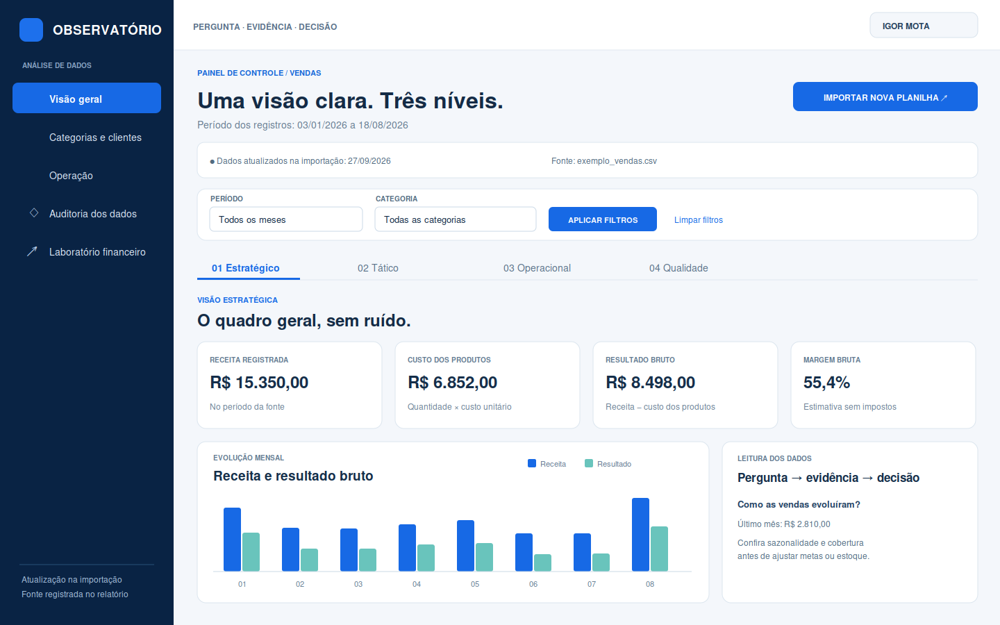

# Observatório de Dados

Projeto didático de análise de dados com **Flask, HTML, CSS, Bootstrap, pandas, NumPy e Chart.js**. O roteiro de trabalho segue a prática de carregar, verificar, transformar, agrupar e comunicar dados, inspirada no estudo de *Python para Análise de Dados*. Os textos, exemplos e código deste projeto são originais.

## Visual do painel



*Prévia ilustrativa criada com os dados fictícios de `data/exemplo_vendas.csv`. Ao executar o Flask no navegador, os números e filtros seguem a planilha importada.*

## O que existe no projeto

1. **Painel de vendas:** importa CSV ou XLSX, valida os campos, mostra fonte e alertas, apresenta três visões (operacional, tática e estratégica), filtros de mês e categoria, gráficos mensais e por categoria, e cartões em formato pergunta → evidência → decisão. A tela clara usa menu lateral, cartões e barra de filtros inspirados na imagem do ERP Midishift fornecida para este projeto.
2. **Laboratório financeiro:** calcula ROE, ROI simplificado, EBITDA aproximado, dívida líquida, dívida líquida/EBITDA e liquidez corrente com valores digitados de demonstrações. Os valores informados devem usar o mesmo período e entidade.
3. **Mercado:** importa uma série histórica de um ativo, plota fechamento e médias móveis, calcula mínimo/máximo dos últimos 20 pregões, VaR histórico de um dia a 95%, choque hipotético de −20% e treina uma regressão linear experimental para o próximo fechamento. A validação separa o trecho final da série no tempo e compara com a regra simples de repetir o último preço.
4. **Saídas:** resumo de vendas em CSV, planilha Excel com quatro abas, gráficos em PNG, impressão e opção de salvar PDF pelo navegador, incluindo gráficos quando a biblioteca de gráficos estiver disponível. Os downloads tabulares seguem os filtros ativos.

> A visão do painel muda após uma **nova importação**. Não há integração em tempo real com ERP, corretora ou API. O laboratório não calcula valuation, não monta carteira diversificada e não constitui recomendação de investimento.

## Executar no Windows (PowerShell)

Abra a pasta `analise-dados-flask` no VS Code e rode no terminal:

```powershell
py -m venv .venv
.\.venv\Scripts\Activate.ps1
python -m pip install -r requirements.txt
python run.py
```

Acesse `http://127.0.0.1:5000`. Se `py` não estiver disponível, use `python -m venv .venv`. No Prompt de Comando, a ativação é `.venv\Scripts\activate.bat`.

Baixe o modelo na página inicial ou use os arquivos em `data/`. Os dados de exemplo são **fictícios**.

### Modelo de vendas

| Coluna | Significado | Exemplo |
| --- | --- | --- |
| `data` | Data da venda (`DD/MM/AAAA` ou `AAAA-MM-DD`) | `15/03/2026` |
| `cliente` | Identificador do cliente | `Cliente A` |
| `produto` | Item registrado | `Mouse` |
| `categoria` | Agrupamento do item | `Tecnologia` |
| `quantidade` | Unidades; valor não negativo | `2` |
| `preco_unitario` | Valor por unidade | `85,00` |
| `custo_unitario` | Custo por unidade | `52,00` |

CSV pode usar `;` ou `,` como separador; o arquivo exemplo usa `;`. Excel aceita números nativos. Datas inválidas, campos em branco e valores negativos impedem a importação e são indicados por linha. Linhas duplicadas e preços zero geram alertas e são preservados. Um registro é **item de venda**, e não necessariamente um pedido único.

### Modelo de preços

| Coluna | Significado | Exemplo |
| --- | --- | --- |
| `data` | Data do pregão em `AAAA-MM-DD` | `2026-03-15` |
| `fechamento` | Preço ajustado ou não, conforme a mesma fonte, positivo e com ponto decimal | `50.75` |
| `volume` | Campo opcional para futura análise | `15000` |

Use **100 a 10.000 pregões**, um preço por data, organizados pela mesma convenção. O programa ordena datas e exige preços válidos. Ajustes por dividendos/desdobramentos precisam ser feitos na fonte: ignorá-los distorce retornos, risco e médias.

## Fórmulas e limites

- Vendas: `receita = quantidade × preço_unitario`; `resultado bruto estimado = receita − quantidade × custo_unitario`; `margem = resultado / receita` (quando receita > 0). Impostos, fretes, despesas e devoluções estão fora desta base.
- ROE = lucro líquido / patrimônio líquido informado. ROI **simplificado** = lucro líquido / capital investido informado; o conceito de ROI varia conforme o problema, por isso a convenção aparece na interface.
- EBITDA **aproximado** = EBIT informado + depreciação e amortização informadas. Dívida líquida = dívida bruta − caixa. Dívida líquida/EBITDA não é exibida quando EBITDA ≤ 0. Liquidez corrente = ativo circulante / passivo circulante.
- Médias móveis de 20 e 50 pregões são descritivas. O mínimo/máximo de 20 pregões são observações históricas, não níveis garantidos.
- VaR usa o percentil empírico de 5% dos retornos diários multiplicado pela posição, com limite inferior em zero. **Não é a perda máxima**: perdas na cauda podem excedê-lo. Choque de 20% é apenas um cenário.
- A regressão linear usa último fechamento e médias históricas de 5 e 20 dias como variáveis. Treina com os primeiros 80% dos exemplos e valida nos 20% finais em ordem temporal. A previsão é experimental; não há garantia fora da amostra.

## Estrutura

```text
analise-dados-flask/
├── app/
│   ├── __init__.py          # Fábrica Flask, rotas e downloads
│   ├── analysis.py          # Validação e análise de vendas
│   ├── finance.py           # Indicadores, preços, risco e modelo linear
│   ├── templates/           # Páginas HTML
│   └── static/              # CSS e JavaScript
├── data/                    # Dados sintéticos de treinamento
├── requirements.txt
└── run.py
```

Uploads de vendas são guardados em `instance/uploads/` na máquina que executa o servidor. Para excluir um arquivo importado, apague o respectivo conteúdo dessa pasta com o aplicativo parado. Dados financeiros digitados e séries de preços do laboratório são processados na requisição e não salvos pelo projeto.

## Evolução sugerida

1. Adicionar filtros de período, categoria e cliente, com testes de consistência dos totais.
2. Criar autenticação, permissões, remoção automática dos uploads e banco de dados antes de publicar online.
3. Integrar uma fonte autorizada para atualizações contínuas; registrar hora, falhas e histórico de cada ingestão.
4. Para dados de empresas, importar balanço, DRE e fluxo de caixa do mesmo período e reconciliação, antes de propor valuation. Para risco de carteira, trabalhar correlação, pesos e testes de estresse por ativos.

**Uso local/educativo.** O servidor de desenvolvimento do Flask e a chave secreta padrão em `app/__init__.py` não são adequados para disponibilização pública. O CSS Bootstrap e o Chart.js são carregados por CDN; sem acesso à internet, os valores e tabelas ainda aparecem, mas os gráficos e parte do estilo dependem dessa conexão.
